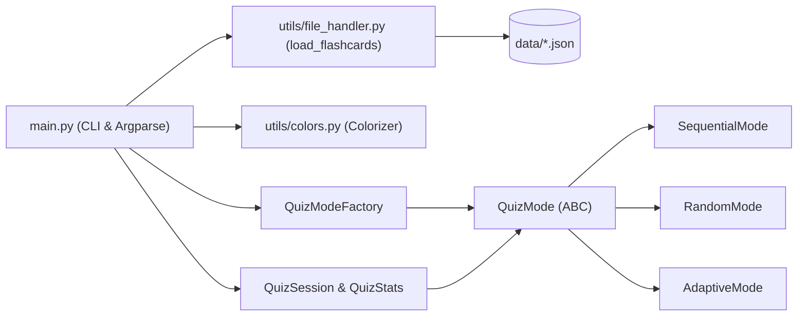

# Flashcard Quizzer

A command-line flashcard app built with an AI coding agent. Load a deck from
JSON, choose how questions are served (in order, shuffled, or adaptive), and
get colored feedback and end-of-session statistics.

```
$ python main.py -m adaptive -f data/python_basics.json --stats
Flashcard Quizzer - python_basics.json (11 cards, adaptive mode)
Type 'exit' or press Ctrl+C to quit.

Question 1: Which keyword defines a function?
> def
Correct!                                   <- green

Question 2: Which built-in function returns the number of items in a list?
> size
Incorrect. The answer is: len              <- red
...
```

## Features

- **Two JSON deck formats**: a plain array of cards, or an object with a
  `"cards"` list (extra keys such as `"title"` are ignored).
- **Friendly validation**: malformed JSON, a missing file, a missing or empty
  `front`/`back`, or the wrong structure all produce a one-line error message
  and exit code 1, never a Python traceback.
- **Three quiz modes** (Strategy pattern, chosen through a Factory):
  - `sequential`: every card once, in deck order.
  - `random`: every card once, shuffled.
  - `adaptive`: every card in deck order, but a missed card is asked again
    after the next two cards instead of waiting for the end of the deck.
    Each card is asked at most 3 times, so a session always ends.
- **Colored feedback**: green for correct, red for incorrect. Colors are
  turned off automatically when output is piped, when `NO_COLOR` is set, or
  with `--no-color`.
- **Graceful exit**: type `exit` (or `quit`) at any prompt, or press
  Ctrl+C / Ctrl+D. You still get your score for the questions answered.
- **Statistics**: a score line is always shown; `--stats` adds a detailed
  report (answered, correct, incorrect, accuracy, unique cards seen, and the
  cards to review, most-missed first).

Answers are compared case-insensitively with extra whitespace ignored
(`"  Design   PATTERN "` matches `"Design pattern"`). Punctuation is kept, so
`=` does not match `==`.

## Setup

Requires Python 3.10 or newer. The app itself has no third-party
dependencies; the packages in `requirements.txt` are for testing and linting.

```bash
python3 -m venv .venv
```

```bash
source .venv/bin/activate
```

```bash
pip install -r requirements.txt
```

## Usage

```bash
python main.py -f data/python_basics.json
```

```bash
python main.py -m adaptive -f data/python_basics.json --stats
```

| Flag | Description |
| --- | --- |
| `-f`, `--file FILE` | Deck to study (required). |
| `-m`, `--mode {sequential,random,adaptive}` | Question order. Default `sequential`; case-insensitive. |
| `--stats` | Show the detailed statistics report at the end. |
| `--no-color` | Disable ANSI colors. |
| `-h`, `--help` | Show help. |

Exit codes: `0` quiz finished or stopped by the user, `1` the deck could not
be loaded, `2` invalid command-line arguments, `130` Ctrl+C pressed before the
first question appeared.

## Deck format

Array format (`data/glossary.json`):

```json
[
  {"front": "A last-in, first-out (LIFO) collection", "back": "Stack"},
  {"front": "A first-in, first-out (FIFO) collection", "back": "Queue"}
]
```

Object format (`data/python_basics.json`, `data/design_patterns.json`):

```json
{
  "title": "Python Basics",
  "cards": [
    {"front": "Which keyword defines a function?", "back": "def"}
  ]
}
```

Rules: each card must be an object with non-empty `front` and `back` values.
Field names are case-insensitive (`"Back"` works), surrounding whitespace is
trimmed, and numbers are accepted (`"back": 8`). Other keys are ignored.

Bundled decks: `glossary.json` (programming terms, array format),
`python_basics.json` (Python syntax, object format) and
`design_patterns.json` (design patterns, object format).

## Project structure

```
main.py                 CLI entry point: argparse, quiz loop, colors, summary
quiz_engine.py          QuizMode (abstract strategy), SequentialMode,
                        RandomMode, AdaptiveMode, QuizModeFactory,
                        QuizSession, QuizStats, answer checking
utils/file_handler.py   load_flashcards(): JSON loading and validation
utils/colors.py         ANSI color helpers and terminal detection
data/                   Sample decks
tests/                  pytest suite (loader, quiz modes, CLI, integration)
docs/                   AI interaction log, project report, coverage report
```

### Design patterns

- **Strategy**: `QuizMode` is an abstract base class. Each mode implements
  `_initial_order()` (and, for adaptive, the `_on_answer()` hook). A
  `QuizSession` uses only the `next_card()` / `record_answer()` interface,
  so modes are interchangeable.
- **Factory**: `QuizModeFactory.create(name, cards)` turns the `-m` value
  into the right `QuizMode` instance. The CLI never names a concrete class,
  and argparse's `choices` come from `QuizModeFactory.available_modes()`.

To add a mode, subclass `QuizMode`, set `name`, implement `_initial_order()`
and add the class to the tuple that builds `QuizModeFactory._modes`.



## Testing and code quality

```bash
python -m pytest tests/
```

```bash
python -m pytest --cov=. --cov-report=html
```

```bash
flake8
```

Current results: **90 tests pass**, **100% coverage** of application code
(tests, the virtualenv and the `if __name__ == "__main__":` block are
excluded in `pyproject.toml`), and flake8
reports no errors. The HTML report is written to `htmlcov/index.html` (git
ignores it); a text copy is committed at
[`docs/coverage_report.txt`](docs/coverage_report.txt).

| Test file | What it covers |
| --- | --- |
| `tests/test_flashcard_loader.py` | Array/object formats, invalid JSON, missing/empty fields, bad structure, missing/unreadable files, the bundled decks |
| `tests/test_quiz_modes.py` | Factory, abstract base class, ordering of each mode, adaptive re-asking and attempt cap, answer matching, stats |
| `tests/test_cli.py` | Argument parsing, color handling, summary formatting |
| `tests/test_integration.py` | Full sessions through the CLI with scripted input, `exit`/Ctrl+C/Ctrl+D, friendly errors, and real subprocess runs |

## Documentation

- [`docs/ai_edit_log.md`](docs/ai_edit_log.md): AI interaction log (prompt
  refinements and logic corrections).
- [`docs/report.md`](docs/report.md): final project report.
